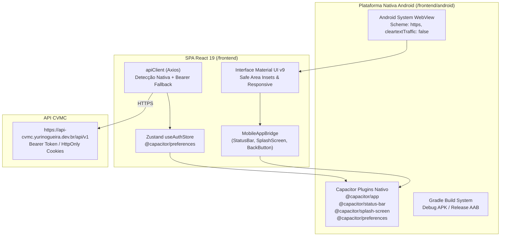

# 📱 Empacotamento Mobile Android e Guia de Build com Capacitor

Este documento descreve o fluxo canônico de engenharia e operações para desenvolvimento, sincronização e compilação do aplicativo móvel nativo **CVMC (Como Vai Meu Carro)** para a plataforma **Android**, utilizando o ecossistema **Capacitor 8**.

Para navegação geral, retorne ao [Catálogo Canônico](../index.md).

---

## 🏗️ Arquitetura do Shell Nativo Mobile

O aplicativo Android do CVMC opera através de um shell nativo leve acoplado à SPA React 19 do diretório `frontend/`:



### Configurações de Identificação e Segurança
- **Identificador do Aplicativo (App ID)**: `com.cvmc.app`
- **Nome da Aplicação**: `CVMC`
- **Diretório de Web Assets**: `dist`
- **Segurança de Rede**: `android:usesCleartextTraffic="false"` no `AndroidManifest.xml`, garantindo tráfego 100% via HTTPS.
- **Autenticação em WebView**: Detecção automática de ambiente nativo com `Capacitor.isNativePlatform()`. Os dados do usuário e os tokens de sessão (`accessToken` e `refreshToken`) são persistidos de maneira segura no sandbox nativo via `@capacitor/preferences` e transmitidos com o cabeçalho `Authorization: Bearer <token>`. No bootstrap do aplicativo, `initAuthSession` restaura a sessão assincronamente com controle de prontidão (`isInitializing`), mantendo a SplashScreen ativa até a resolução e garantindo que o login dure 30 dias com silent refresh automático.

---

## 🛠️ Pré-Requisitos de Ambiente

Para gerar os pacotes nativos compilados (`.apk` ou `.aab`), a máquina ou servidor de build deve possuir:

1. **Node.js** >= 20 e **npm** >= 10.
2. **Java Development Kit (JDK)**: JDK 17 ou 21 (recomendado Azul Zulu ou OpenJDK).
3. **Android SDK / Android Studio**:
   - `ANDROID_HOME` configurado (ex: `/home/usuario/Android/Sdk` ou `C:\Users\usuario\AppData\Local\Android\Sdk`).
   - Android SDK Command-line Tools e Build-Tools (API 34 ou 35).
   - Android Platform SDK 35 (`android-35`).

---

## ⚡ Comandos e Scripts Rápidos de Desenvolvimento

Todos os scripts estão mapeados em `frontend/package.json`:

```bash
# 1. Compilar o frontend web e sincronizar com o projeto nativo Android
npm --prefix frontend run cap:build

# 2. Sincronizar plugins e cópia rápida de assets após build web
npm --prefix frontend run cap:sync

# 3. Abrir o projeto diretamente no Android Studio
npm --prefix frontend run cap:open
```

---

## 📦 Geração de Builds via Terminal (Gradle)

Navegue até a pasta nativa `frontend/android`:

### 1. Build de Debug (APK de Teste Local)
```bash
cd frontend/android
./gradlew assembleDebug
```
- **Localização do artefato gerado**:
  `frontend/android/app/build/outputs/apk/debug/app-debug.apk`

### 2. Build de Produção (Android App Bundle - AAB para Google Play)
```bash
cd frontend/android
./gradlew bundleRelease
```
- **Localização do artefato gerado**:
  `frontend/android/app/build/outputs/bundle/release/app-release.aab`

---

## 🔑 Assinatura e Keystore para Publicação na Google Play

Para publicar na Google Play Store, o pacote `.aab` deve ser assinado com uma chave privada RSA de 2048+ bits:

### 1. Geração da Chave Privada (Keystore)
> [!CAUTION]
> Guarde o arquivo `cvmc-release-key.jks` e suas senhas em um cofre seguro (ex: 1Password, Bitwarden ou Secrets do repositório). A perda desta chave impede o envio de atualizações para a Google Play Store.

```bash
keytool -genkey -v \
  -keystore cvmc-release-key.jks \
  -alias cvmc-key \
  -keyalg RSA \
  -keysize 2048 \
  -validity 10000
```

### 2. Configuração de Variáveis ou `gradle.properties`
Em ambiente de CI/CD ou local seguro, configure no `~/.gradle/gradle.properties`:

```properties
CVMC_RELEASE_STORE_FILE=/caminho/seguro/cvmc-release-key.jks
CVMC_RELEASE_KEY_ALIAS=cvmc-key
CVMC_RELEASE_STORE_PASSWORD=senha_do_keystore
CVMC_RELEASE_KEY_PASSWORD=senha_da_chave
```

---

## 🤖 Compilação Automatizada no GitHub Actions

A pipeline de Frontend (`.github/workflows/frontend.yml`) compila automaticamente os pacotes Android (`.aab` e `.apk`) a cada push na branch `main` e em Pull Requests:
1. Constrói a SPA com as variáveis de produção (`VITE_GOOGLE_CLIENT_ID` e `VITE_API_BASE_URL`).
2. Injeta automaticamente o `frontend/android/app/google-services.json` a partir da secret `GOOGLE_SERVICES_JSON` (se configurada no GitHub Actions).
3. Sincroniza os web assets com o projeto nativo via `npx cap sync android`.
4. Decodifica temporariamente a keystore oficial de release a partir da secret `ANDROID_KEYSTORE_BASE64` (junto com `ANDROID_KEY_ALIAS`, `ANDROID_KEYSTORE_PASSWORD` e `ANDROID_KEY_PASSWORD`) e executa `./gradlew assembleDebug bundleRelease assembleRelease`, removendo a keystore temporária ao término do step.
5. Disponibiliza na aba **Artifacts** da execução no GitHub Actions:
   - `app-release-aab` (`app-release.aab` assinado, pronto para upload no Google Play Console);
   - `app-release-apk` (`app-release.apk` assinado com `SHA-1` oficial fixo para instalação direta no celular);
   - `app-debug-apk` (`app-debug.apk`).

---

## 🔐 Autenticação Social Google no Android (Google Credential Manager)

O Google bloqueia explicitamente fluxos de autenticação web baseados em popups/postMessage dentro de WebViews embutidas no Android (`disallowed_useragent`). Para viabilizar login e vínculo social no app Android, o CVMC adota o plugin nativo `@capgo/capacitor-social-login`, acoplado ao moderno **Android Credential Manager** (`androidx.credentials`):

### 1. Configuração no Google Cloud Console
No mesmo projeto do Google Cloud onde reside o Client ID Web (`ID do cliente para Aplicativo da Web`):
1. Acesse **APIs e Serviços > Credenciais > Criar Credenciais > ID do cliente OAuth**.
2. Selecione o tipo de aplicativo **Android**.
3. Preencha o nome do pacote: `com.cvmc.app`.
4. Adicione a impressão digital do certificado SHA-1:
   - **Ambiente de Testes / Debug Local**:
     ```
     D6:0C:13:47:7D:E7:29:43:DF:AA:FB:B3:F5:10:00:BC:5A:7D:AF:02
     ```
     *(Gerado a partir do `~/.android/debug.keystore` local)*.
   - **Ambiente de Produção**:
     O SHA-1 da chave privada `cvmc-release-key.jks` ou da chave de assinatura do app gerada pelo Google Play App Signing.
5. O Web Client ID continua sendo informado na variável `VITE_GOOGLE_CLIENT_ID` (frontend) e `GOOGLE_CLIENT_ID` (backend Go), sendo repassado como `webClientId` para o Credential Manager gerar um ID Token válido para a audiência da API.

---

## 🔔 Notificações Push com Firebase Cloud Messaging (FCM)

O aplicativo mobile integra o plugin oficial `@capacitor/push-notifications` conectado à API **Firebase Cloud Messaging HTTP v1** no backend Go:

1. **Permissões Android 13+ (API 33+)**:
   - O `AndroidManifest.xml` declara `android.permission.POST_NOTIFICATIONS` e o canal padrão `cvmc_alerts`.
   - Ao autenticar no aplicativo nativo, o `pushNotificationService` cria o canal `cvmc_alerts` (importância máxima, som e vibração ativos) e solicita permissão em tempo de execução.
2. **Ciclo de Vida do Device Token**:
   - No login/inicialização, o token FCM obtido é registrado em `POST /api/v1/devices/token` (`platform: "android"`).
   - No logout (`Topbar.tsx`), o token é imediatamente desvinculado via `DELETE /api/v1/devices/token` para evitar notificações para outra conta no mesmo aparelho.
   - Tokens desinstalados ou expirados (`UNREGISTERED`) são limpos automaticamente pelo backend no momento do disparo.
3. **Configuração do `google-services.json`**:
   - Copie `frontend/android/app/google-services.json.example` para `frontend/android/app/google-services.json` (ignorado pelo Git) com as credenciais do projeto Firebase associado ao pacote `com.cvmc.app`.
   - No backend, configure `FIREBASE_CREDENTIALS_JSON` ou `FIREBASE_CREDENTIALS_FILE` com a chave da conta de serviço do Firebase.

---

## 🎨 Ativos Visuais, Ícones Adaptativos e Google Play Store

Todos os recursos gráficos nativos do Android e os ativos exigidos pelo **Google Play Console** seguem a identidade visual oficial do CVMC (silhueta frontal do veículo em branco sobre azul primário `#0284C7` e gradiente institucional `#0284C7` → `#0369A1` → `#0F766E`):

### 1. Ativos para Submissão no Google Play Console (`frontend/android/playstore-assets/`)
| Arquivo | Dimensões | Formato | Finalidade no Google Play Console |
| :--- | :--- | :--- | :--- |
| `playstore-icon-512.png` | `512 x 512` px | PNG 32-bit RGBA (*full-bleed*, `< 1 MB`) | **Ícone do app em alta resolução** (quadrado completo sem cantos pré-arredondados; a Google Play aplica automaticamente o raio de 30% e sombra). |
| `feature-graphic-1024x500.png` | `1024 x 500` px | PNG 24-bit RGB (sem canal alfa) | **Gráfico de Recurso (*Feature Graphic*)** exibido no topo da página da loja e em destaques promocionais. |

### 2. Ícones Nativos Android (`frontend/android/app/src/main/res/`)
- **Launcher Legacy & Round (`ic_launcher.png` e `ic_launcher_round.png`)**:
  - `mipmap-mdpi`: `48x48` px
  - `mipmap-hdpi`: `72x72` px
  - `mipmap-xhdpi`: `96x96` px
  - `mipmap-xxhdpi`: `144x144` px
  - `mipmap-xxxhdpi`: `192x192` px
- **Adaptive Icons (Android 8.0+ / API 26+ e Android 13+ Themed Icons)**:
  - Camada de primeiro plano (`ic_launcher_foreground.png`) centralizada na zona segura de `66x66 dp` dentro do canvas de `108x108 dp`: `mdpi` (`108x108`), `hdpi` (`162x162`), `xhdpi` (`216x216`), `xxhdpi` (`324x324`), `xxxhdpi` (`432x432`).
  - Cor de plano de fundo oficial `#0284C7` definida em `values/ic_launcher_background.xml` e `drawable/ic_launcher_background.xml`.
  - Camada vetorial e monocromática (`<monochrome android:drawable="@drawable/ic_launcher_foreground"/>` em `mipmap-anydpi-v26/ic_launcher.xml` e `ic_launcher_round.xml`, apontando para `drawable-v24/ic_launcher_foreground.xml`).
- **Ícone de Barra de Status para Notificações Push FCM (`drawable/ic_stat_cvmc.xml`)**:
  - Vetor monocromático branco (`#FFFFFF`) sobre fundo transparente (`24x24 dp`) referenciado no `AndroidManifest.xml` via `com.google.firebase.messaging.default_notification_icon` com cor de destaque `@color/ic_notification_color` (`#0284C7` em `values/colors.xml`).
- **Splash Screens Nativas (`splash.png`)**:
  - 11 variações em `drawable/splash.png`, `drawable-port-{mdpi..xxxhdpi}/splash.png` (`320x480` a `1280x1920`) e `drawable-land-{mdpi..xxxhdpi}/splash.png` (`480x320` a `1920x1280`) com fundo `#0284C7` e emblema centralizado na zona segura de corte (`CENTER_CROP`).

### 3. Ícones PWA, Maskable e Open Graph (`frontend/public/`)
- `pwa-192x192.png` (`192x192` px, `purpose: "any"`)
- `pwa-512x512.png` (`512x512` px, `purpose: "any"`)
- `maskable-icon-512x512.png` (`512x512` px, `purpose: "maskable"` com zona segura W3C de 80%)
- `og-image.png` (`1200x630` px para compartilhamento social Open Graph / Twitter Card)

---

## 🧪 Validação e Checklist Pré-Publicação

Antes de submeter uma nova versão à Google Play:
- [ ] Executar `./scripts/check.sh all` na raiz do projeto (100% verde).
- [ ] Garantir que o `versionCode` e `versionName` foram incrementados em `frontend/android/app/build.gradle`.
- [ ] Validar a navegação via hardware back button no dispositivo físico ou emulador Android.
- [ ] Validar autenticação e silent refresh funcionando via conexão externa HTTPS.
- [ ] Validar login e vínculo com conta Google via Credential Manager nativo.
- [ ] Validar permissão `POST_NOTIFICATIONS`, recebimento de push e navegação via *deep-link*.
- [ ] Testar Safe Area Insets em aparelhos com entalhe/camera cutout e barra de gestos.
- [ ] Confirmar que a URL pública de Política de Privacidade (`https://cvmc.yurinogueira.dev.br/privacy`) e a URL de Exclusão de Conta (`https://cvmc.yurinogueira.dev.br/privacy#exclusao-de-conta`) estão preenchidas na seção **Conteúdo do App / Segurança dos Dados** do Google Play Console.
